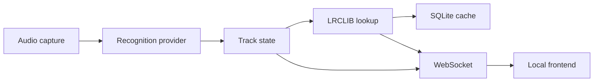

# vinyl-lyrics

Local Windows application that listens to turntable audio, identifies the
playing track, and displays synchronized lyrics in a full-screen player.

[](LICENSE)
[](pyproject.toml)
[](https://github.com/miausalvaje/vinyl-lyrics/actions/workflows/ci.yml)

> **Demo:** TODO: add `docs/images/screenshot.png` or a demonstration GIF.

## Features

- Continuous audio capture from a microphone, line-in device, or supported Windows WASAPI loopback source.
- Synchronized lyrics from LRCLIB, with plain-lyrics fallback.
- TODO: Full-screen Apple Music-inspired interface with artwork and blurred background.
- Local SQLite lyrics cache.
- Interchangeable recognition providers: Shazam, ACRCloud, and AudD.

Some UI polish and provider integrations are still under active development.
Incomplete areas are marked with `TODO` in the source tree.

## How it works



## Requirements

- Python 3.11 or newer.
- Windows is the primary supported platform.
- An input-capable audio device and its Windows driver.
- Optional provider credentials for ACRCloud or AudD.

> Linux and macOS should work in principle, but they are not currently tested.

## Installation

```powershell
git clone https://github.com/miausalvaje/vinyl-lyrics.git
cd vinyl-lyrics
py -3.11 -m venv .venv
.venv\Scripts\Activate.ps1
python -m pip install --upgrade pip
python -m pip install -e ".[dev]"
copy .env.example .env
```

## Configuration

Edit [config.yaml](config.yaml) for runtime settings and `.env` for secrets.
Never commit `.env`.

| Option | Default | Description |
| --- | --- | --- |
| `audio.source_id` | `null` | Stable source id such as `input:0` or `loopback:3`. |
| `audio.buffer_seconds` | `15` | Circular audio history used by analysis and recognition. |
| `audio.gain_db` | `0` | Gain applied before spectrum and silence analysis. |
| `audio.sample_rate` | `44100` | Capture sample rate in Hz. |
| `recognition.provider` | `shazam` | `shazam`, `acrcloud`, or `audd`. |
| `recognition.interval_seconds` | `45` | Re-identification interval. |
| `lyrics.lrclib_base_url` | `https://lrclib.net/api` | LRCLIB API endpoint. |
| `lyrics.cache_path` | `data/lyrics.sqlite3` | Local SQLite cache path. |
| `server.host` | `127.0.0.1` | Local bind address. |
| `server.port` | `8000` | Local HTTP port. |

Runtime settings are persisted in `settings.json` under the platform user
configuration directory. The API exposes `GET /api/settings`, `PUT
/api/settings`, `GET /api/sources`, and `POST /api/source`.

The main WebSocket (`/ws`) emits state, track, source, error, and idle events.
The independent `/ws/spectrum` socket emits 64 logarithmic spectrum bands,
RMS, peak, and dBFS values when a consumer is connected.

## Usage

List available input devices:

```powershell
python scripts\list_audio_devices.py
```

Start the local application:

```powershell
vinyl-lyrics
```

Open `http://127.0.0.1:8000/` in a browser. The planned keyboard controls are:

- `F`: toggle full-screen mode.
- Left/right arrows: adjust the lyric offset.
- `Esc`: leave full-screen mode.

> TODO: finish wiring keyboard offset controls into the frontend.

For a kiosk-style launch, use a Chromium-based browser:

```powershell
start msedge --kiosk http://127.0.0.1:8000/ --edge-kiosk-type=fullscreen
```

## Recognition providers

### Shazam

Shazam via `shazamio` is the default provider and does not require an API key.
It is selected with `recognition.provider: shazam`.

### ACRCloud

Set `recognition.provider: acrcloud` and provide `ACR_HOST`,
`ACR_ACCESS_KEY`, and `ACR_ACCESS_SECRET` in `.env`.

> TODO: complete the ACRCloud request implementation.

### AudD

Set `recognition.provider: audd` and provide `AUDD_API_TOKEN` in `.env`.

> TODO: complete the AudD request implementation.

## Tips for vinyl

- Prefer the phono preamp or receiver line output connected to line-in over an
  ambient microphone. This produces a cleaner recognition signal.
- Keep the record volume stable and avoid clipping the input.
- The application calculates `started_at` as the current monotonic time minus
  the recognition offset.
- During periodic re-identification, the offset is corrected when the detected
  position differs by more than 1.5 seconds.

## Troubleshooting

### The song is not recognized

Check the selected input with `python scripts\list_audio_devices.py`, verify
that the record is audible in Windows, and try a clean line-in signal.

### The lyrics are out of sync

Use the planned left/right offset controls. Re-identification also corrects
drift greater than 1.5 seconds.

### No lyrics are shown

Check the track metadata and network access to LRCLIB. Some tracks only have
plain lyrics or are unavailable from the service.

### The audio device cannot be found

Set `audio.device` to the exact device name or numeric index shown by the
device-listing script.

## Roadmap

- Complete the polished frontend and visual themes.
- Add Docker support.
- Add more recognition and lyrics providers.
- Add configurable keyboard and remote controls.
- Add packaging for Windows releases.

## Contributing

See [CONTRIBUTING.md](CONTRIBUTING.md) for development setup, tests, linting,
commit conventions, and pull request guidance.

## License

This project is licensed under the MIT License. See [LICENSE](LICENSE).

## Acknowledgements

Thanks to LRCLIB, `shazamio`, FastAPI, `sounddevice`, and the other open-source
libraries used by this project.

## Disclaimer

`shazamio` is an unofficial library and may stop working or be subject to
Shazam's terms of service. Lyrics belong to their respective copyright holders;
this application does not redistribute them and only displays and caches them
locally for personal use. This project is not affiliated with Apple, Shazam,
or LRCLIB.
