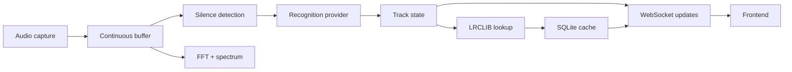

# VinylSync

Local Windows-first application that listens to turntable audio, identifies the current song, and displays synchronized lyrics in a full-screen, Apple Music-inspired interface.

[](LICENSE)
[](pyproject.toml)
[](https://github.com/miausalvaje/VinylSync/actions/workflows/ci.yml)

> Demo image: TODO add `docs/images/screenshot.png` before publishing the project.

## Features

- Continuous audio capture from microphone or line-in, plus Windows WASAPI loopback support when available.
- Real-time spectrum analysis and hysteresis-based silence detection.
- Track recognition via Shazam by default, with ACRCloud and AudD adapters kept as optional providers.
- LRCLIB lookups with synced lyrics and plain-lyrics fallback.
- Local SQLite cache for lyrics and cover URLs.
- Full-screen frontend with visualizer, lyrics view, settings panel, and manual track correction.
- Persistent per-user settings stored in the platform config directory.

## How it works



## Requirements

- Python 3.11+
- Windows as the primary supported platform
- An available input or line-in device, or Windows WASAPI loopback support
- Optional credentials for recognition providers that are not using Shazam

> Linux and macOS should work in principle, but they are not actively tested in CI.

## Installation

```powershell
git clone https://github.com/miausalvaje/VinylSync.git
cd VinylSync
py -3.11 -m venv .venv
.\.venv\Scripts\Activate.ps1
python -m pip install --upgrade pip
python -m pip install -e ".[dev]"
copy .env.example .env
```

## Configuration

Edit [config.yaml](config.yaml) for defaults and `.env` for provider secrets.
Do not commit `.env`.

| Option | Default | Description |
| --- | --- | --- |
| `audio.source_id` | `null` | Stable source ID such as `input:0` or `loopback:3`. |
| `audio.buffer_seconds` | `15` | Circular audio history kept in memory. |
| `audio.gain_db` | `0` | Gain applied before analysis. |
| `audio.sample_rate` | `44100` | Capture sample rate in Hz. |
| `recognition.provider` | `shazam` | Provider name: `shazam`, `acrcloud`, or `audd`. |
| `recognition.interval_seconds` | `45` | Re-identification interval. |
| `recognition.min_signal_seconds` | `1.0` | Minimum sustained signal before a recognition attempt. |
| `recognition.track_gap_seconds` | `1.5` | Minimum silence duration to treat a pause as a gap (does not discard the track on its own). |
| `recognition.break_max_seconds` | `10` | Maximum silence duration during a track before assuming playback has stopped (needle lifted). |
| `recognition.end_margin_seconds` | `10` | Margin before track end to treat a silence as a track boundary or song transition. |
| `recognition.idle_timeout_seconds` | `20` | Time of continuous silence before returning to the visualizer. |
| `recognition.min_sample_seconds` | `5` | Minimum new audio required after silence before recognition restarts. |
| `lyrics.lrclib_base_url` | `https://lrclib.net/api` | LRCLIB API base URL. |
| `lyrics.cache_path` | `data/lyrics.sqlite3` | Local SQLite cache file. |
| `server.host` | `127.0.0.1` | Local bind address. |
| `server.port` | `8000` | Local HTTP port. |
| `server.allowed_hosts` | `[]` | Additional local hostnames allowed when the server is exposed on the LAN. |

Runtime settings are persisted in the platform config directory as `settings.json`.
The API exposes `GET /api/settings`, `PATCH /api/settings`, `GET /api/sources`, `POST /api/source`, and the manual override endpoints.

The main WebSocket (`/ws`) emits state, track, source, error, and idle updates.
The independent `/ws/spectrum` socket emits 64 logarithmic bands, RMS, peak, and dBFS values.

## Usage

List available audio sources:

```powershell
python scripts\list_audio_devices.py
```

Start the application:

```powershell
vinylsync
```

Open `http://127.0.0.1:8000/` in a browser.

Keyboard shortcuts:

- `F`: toggle full-screen mode
- `V`: switch between visualizer and lyrics view
- `S`: open or close settings
- `M`: open the manual track search dialog
- `←` / `→`: adjust the manual offset by `±0.5 s`
- `Esc`: close dialogs and panels

For a kiosk style launch, use a Chromium-based browser:

```powershell
start msedge --kiosk http://127.0.0.1:8000/ --edge-kiosk-type=fullscreen
```

## Recognition providers

### Shazam

Shazam via `shazamio` is the default provider and does not require a local API key.
Set `recognition.provider: shazam` and keep the default configuration.

### ACRCloud

Set `recognition.provider: acrcloud` and provide `ACR_HOST`, `ACR_ACCESS_KEY`, and `ACR_ACCESS_SECRET` in `.env`.

> Experimental: the ACRCloud adapter is present but still intentionally kept as a secondary implementation.

### AudD

Set `recognition.provider: audd` and provide `AUDD_API_TOKEN` in `.env`.

> Experimental: the AudD adapter is present but still intentionally kept as a secondary implementation.

## Tips for vinyl

- **Signal connection**: Prefer the phono preamp or receiver line output instead of an ambient microphone. This produces a cleaner signal for recognition.
- **Calibrating the silence threshold**: Open the Settings panel (`S`) and watch the live audio level meter. Note the background surface noise floor when the needle is in the lead-in groove or between songs (typically -50 to -42 dBFS). Position the silence threshold slider just above this noise floor so that runout grooves register as silence while soft passages in songs register as signal.
- **Mid-song breaks and instrumental pauses (`break_max_seconds`)**: Vinyl tracks frequently have quiet interludes, solo sections, or silent dramatic breaks. VinylSync classifies pauses occurring before the end of the song as *breaks* rather than track boundaries. The playback clock continues running, keeping lyrics on screen and in sync. If a pause lasts longer than `break_max_seconds` (default 10s), the system assumes the turntable was stopped or the tonearm was lifted, safely returning to idle. Tweak this value if your records contain unusually long ambient interludes.
- **Track transitions and runout grooves (`end_margin_seconds`)**: Because vinyl pressings and digital database releases can differ slightly in outro lengths and tempo, `end_margin_seconds` (default 10s) provides a window near the end of the expected track duration. Pauses occurring within this margin are treated as *track boundaries*, cleanly discarding the previous song and preparing to identify the next track as soon as sound resumes.
- **Background verification and drift control**: When sound returns after a mid-song break, VinylSync runs a non-intrusive background verification. If the same track is confirmed, it only adjusts playback position if detected drift exceeds 1.5 seconds, avoiding jarring visual jumps. If a different track is detected, it requests a confirmation sample before switching tracks.
- **Input levels**: Keep the record level stable and avoid clipping the input.

## Troubleshooting

### The song is not recognized

Check the selected source with `python scripts\list_audio_devices.py`, verify that the input is live, and keep the signal above the configured silence threshold.

### The lyrics are out of sync

Use `←` / `→` to adjust the manual offset or tweak `manual_offset_seconds` in the settings UI. If the song is re-identified, the offset is recalculated from the track position.

### No lyrics are shown

Confirm that LRCLIB is reachable and that the track metadata is correct. Some tracks only have plain lyrics or no lyrics available.

### The audio device is not found

Check the source list and set `audio.source_id` to one of the exact IDs returned by the script.

## Roadmap

- Expanded visual themes and more polished choreography.
- Docker support and packaging for Windows releases.
- Additional provider integrations and artwork fallback providers.
- More configurable global keyboard controls and automation hooks.

## Contributing

See [CONTRIBUTING.md](CONTRIBUTING.md) for development setup, tests, linting, commit conventions, and pull request guidance.

## License

This project is licensed under the MIT License. See [LICENSE](LICENSE).

## Acknowledgements

Thanks to LRCLIB, `shazamio`, FastAPI, `sounddevice`, `numpy`, `platformdirs`, and the rest of the open-source ecosystem used by VinylSync.

## Disclaimer

`shazamio` is an unofficial library and may stop working or be subject to Shazam's terms of service. Lyrics belong to their respective copyright holders; this application does not redistribute them and only displays and caches them locally for personal use. This project is not affiliated with Apple, Shazam, or LRCLIB.
