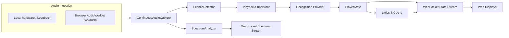
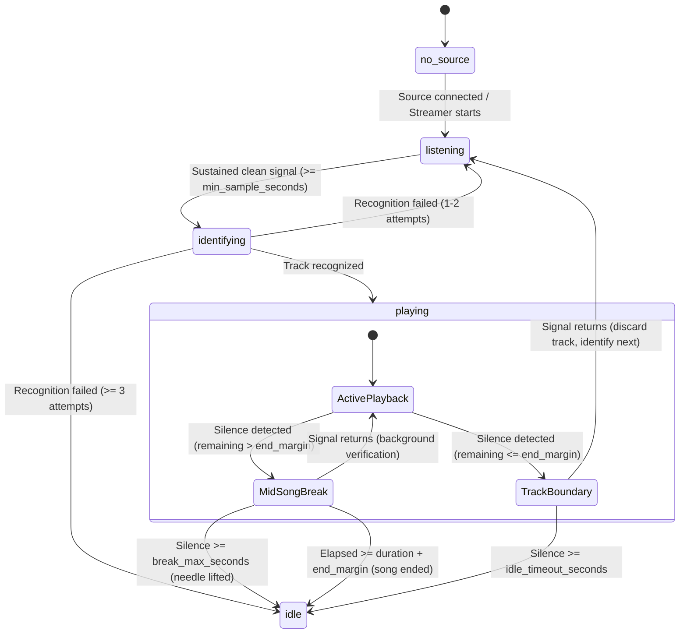

# Architecture

## Overview

`VinylSync` is a local Python service with a static browser frontend. FastAPI serves the web UI, exposes HTTP endpoints, and streams status over WebSockets. It supports both local physical audio hardware (soundcards, USB interfaces, WASAPI loopback) and remote browser-based audio capture over WebSockets for headless or server deployments.

## Modules

- `audio`: discovers and manages local input devices, optional Windows WASAPI loopback sources, and `BrowserStreamSource`; it keeps a single continuous capture stream and a circular buffer of recent audio data.
- `audio.processing`: computes the FFT-based spectrum, RMS/peak metrics, windowed smoothing, and silence detection with hysteresis.
- `recognition`: defines the provider contract and normalizes track metadata before the app updates state.
- `lyrics`: queries LRCLIB, parses LRC text, and stores results in SQLite so the app can reuse them with a local cache.
- `artwork`: resolves and prioritizes cover art from the recognizer data, then falls back to iTunes Search / Cover Art Archive.
- `state`: maintains the active track, monotonic start time, drift tracking, and `PlaybackSupervisor` state transitions.
- `server`: exposes the REST API, security middleware, and WebSocket connections (`/ws`, `/ws/spectrum`, `/ws/audio`).
- `web`: static HTML, CSS, and JavaScript for the fullscreen visualizer, lyrics experience, and AudioWorklet streaming.

## Data flow

1. The selected audio source streams mono audio into a continuous circular buffer (`ContinuousAudioCapture`). When using the browser capture mode, an `AudioWorkletProcessor` collects 2048-sample Int16 PCM frames and sends them over `/ws/audio`. The backend resamples in-memory via NumPy to the internal sample rate (44.1 kHz).
2. The buffer feeds spectrum visualization, silence detection, and 8-second recognition windows without duplicating pipeline logic.
3. Clock synchronization for browser streams is anchored to the arrival of the first frame, tracking elapsed stream time from received sample counts. Lost frames or transmission gaps are zero-filled, while transient network bursts do not drift the calculated recognition timeline.
4. Detection logic only triggers a recognition call when there is sustained signal above the threshold for a configured minimum duration.
5. `PlaybackSupervisor` classifies silences as mid-song breaks, track boundaries, or tonearm lifts, controlling recognition triggers and backoff.
6. The recognizer returns normalized `Track` metadata and optional offset information.
7. LRCLIB is queried through a local cache and fallback search path before lyrics are exposed to the UI.
8. State, track, source, capturer, idle, and error events are broadcast on `/ws`; the spectrum is streamed on `/ws/spectrum`.

## Runtime states

- `no_source`: waiting for an audio source (e.g. server configured with `source_id: browser` with no active browser streamer connected).
- `listening`: the app is actively monitoring audio, but no track has been identified yet.
- `identifying`: an initial or post-boundary recognition request is in flight.
- `playing`: a recognized track is active and lyrics are being displayed. During mid-song breaks, the state remains `playing` and the playback clock keeps running.
- `idle`: prolonged silence or tonearm lift has occurred, or consecutive identification failures have returned the app to the visualizer state.

## Browser audio streaming & Single-sender semantics

- Endpoint: `/ws/audio`. Handshake expects JSON `{"type": "hello", "client_id": "...", "sample_rate": int, "channels": 1, "format": "s16le"}`.
- Concurrency: Only one audio sender is active per `ApplicationRuntime`. Since authenticated users currently have separate runtimes, the sender/takeover restriction is per user session rather than process-global. Each runtime also owns its own capture source; physical device sharing across runtimes depends on the host audio backend and is not coordinated globally.
- Rate limiting: Protected by a token bucket rate limiter (~2x nominal bandwidth with burst tolerance) and a maximum binary frame limit of 64 KB.
- Switching sources: Selecting a server hardware device while a browser is streaming notifies and disconnects the browser with reason `server_device_selected`.

## Security & Reverse Proxies

- **Host & Origin validation**: Normalized hostname checking with proxy port awareness (accepts origins without port 80/443).
- **Proxy trust**: `server.trust_proxy` is only applied when the immediate peer IP matches `server.trusted_proxies` (CIDR/IP whitelist). Untrusted proxy headers (`X-Forwarded-*`) are ignored to prevent spoofing.
- **Token authentication**: Optional `VINYLSYNC_AUTH_TOKEN` environment variable. When set, all REST endpoints (except static files and health checks) require `Authorization: Bearer <token>`, and WebSockets require subprotocol (`vinylsync-auth.<token>`) or an initial authentication message. Brute force attempts are rate-limited per IP address.

## Silence & Playback Supervision

`PlaybackSupervisor` evaluates transitions detected by `SilenceDetector` against track metrics:

