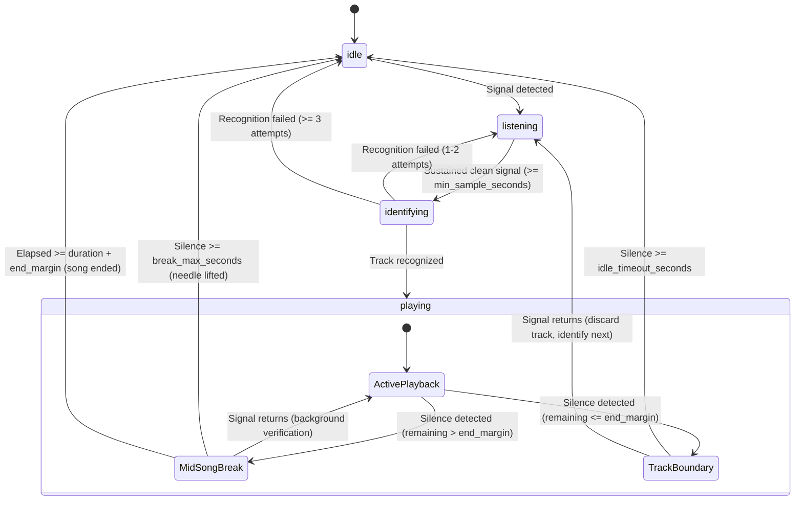

# Architecture

## Overview

`VinylSync` is a local Python service with a static browser frontend. FastAPI serves the web UI, exposes HTTP endpoints, and streams status over WebSockets.

## Modules

- `audio`: discovers and manages input devices and optional Windows WASAPI loopback sources; it keeps a single continuous capture stream and a circular buffer of recent audio data.
- `audio.processing`: computes the FFT-based spectrum, RMS/peak metrics, windowed smoothing, and silence detection with hysteresis.
- `recognition`: defines the provider contract and normalizes track metadata before the app updates state.
- `lyrics`: queries LRCLIB, parses LRC text, and stores results in SQLite so the app can reuse them with a local cache.
- `artwork`: resolves and prioritizes cover art from the recognizer data, then falls back to iTunes Search / Cover Art Archive.
- `state`: maintains the active track, monotonic start time, drift tracking, and re-identification policy.
- `server`: exposes the REST API and WebSocket updates used by the browser.
- `web`: static HTML, CSS, and JavaScript for the fullscreen visualizer and lyrics experience.

## Data flow

1. The selected audio source streams mono, 44.1 kHz audio into a continuous circular buffer.
2. The buffer is used for spectrum visualization, silence detection, and 8-second recognition windows.
3. Detection logic only triggers a recognition call when there is sustained signal above the threshold for a configured minimum duration.
4. The recognizer returns normalized `Track` metadata and optional offset information.
5. `PlayerState` calculates the monotonic start time from the recognition offset and tracks drift during playback.
6. LRCLIB is queried through a local cache and fallback search path before lyrics are exposed to the UI.
7. State, track, source, idle, and error events are broadcast on `/ws`; the spectrum is streamed on `/ws/spectrum`.
8. The browser renders the visualizer, active track, and lyric timeline.

## Runtime states

- `listening`: the app is actively monitoring audio, but no track has been identified yet.
- `identifying`: an initial or post-boundary recognition request is in flight.
- `playing`: a recognized track is active and lyrics are being displayed. During mid-song breaks, the state remains `playing` and the playback clock keeps running.
- `idle`: prolonged silence or tonearm lift has occurred, or consecutive identification failures have returned the app to the visualizer state.

## Silence & Playback Supervision

`PlaybackSupervisor` evaluates transitions detected by `SilenceDetector` against track metrics:

### Silence Classification Rules

1. **Mid-song Break**:
   - Occurs when silence begins while remaining playback time is greater than `recognition.end_margin_seconds` (or when duration is unknown).
   - State remains `playing`. Lyrics remain on screen and `elapsed_seconds` continues to advance monotonically.
   - If silence exceeds `recognition.break_max_seconds`, the supervisor reclassifies the silence as a lifted needle, clears the track, and returns to `idle`.
   - When signal returns, a non-intrusive **background verification** is triggered. The status remains `playing` (no transition to `identifying`).
   - If the same track is confirmed, playback offset is only adjusted if detected drift exceeds 1.5 seconds.
   - If a different track is detected, a second sample is requested for confirmation before switching tracks.
   - A manually locked track (`locked`) is never replaced by background verification.

2. **Track Boundary**:
   - Occurs when silence begins within `recognition.end_margin_seconds` of the track's known duration, or after elapsed time has passed duration.
   - When signal returns, the old track is discarded, status transitions to `listening`, an `idle` event is emitted, and identification is scheduled as soon as clean audio is available.
   - If silence persists past `recognition.idle_timeout_seconds`, status transitions to `idle`.

## HTTP API

- `GET /api/sources` and `POST /api/source` manage the active audio source.
- `GET /api/settings` and `PUT /api/settings` manage persistent settings.
- `GET /api/lyrics/search` searches LRCLIB for manual correction.
- `POST /api/track/override` locks a manually selected track.
- `POST /api/track/unlock` re-enables automatic recognition.

## Notes on source handling

- Input sources are exposed as IDs like `input:0`.
- Loopback sources are listed only on Windows when the platform supports them.
- Source switching is hot-pluggable: the app handles device disappearance, failed starts, and gracefully returns to the idle state.

## Current limitations

- ACRCloud and AudD network implementations remain secondary and are intentionally not treated as the primary path.
- Production polish for the browser UI is still being refined on top of the working architecture.
- Live turntable validation is still the final confirmation step for real-world recognition quality.
